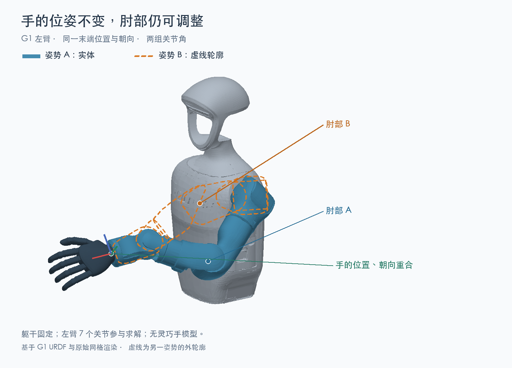

# 4.2 运动学

import G1IKJumpDemo from '../../../components/G1IKJumpDemo.astro';
import G1SingularityDemo from '../../../components/G1SingularityDemo.astro';
import G1ArmForwardKinematicsDemo from '../../../components/G1ArmForwardKinematicsDemo.astro';
import G1ArmInverseKinematicsDemo from '../../../components/G1ArmInverseKinematicsDemo.astro';
import SectionQA from '../../../components/SectionQA.astro';

## 先看一个现场问题

让 G1 的左手向前移动 5 厘米，需要肩、肘、腕几个关节配合。目标说清楚了，接下来还要把它变成各关节的动作：

> **“手要往前移 5 厘米，每个关节该转多少？反过来，知道了关节角，又怎么判断手在哪里、朝向哪边？”**

这就是运动学（Kinematics）要回答的问题：**关节怎么摆，决定了手脚在哪里、怎样运动。** 本节先看位置和姿态的关系，再看速度如何换算。至于完成动作需要多大的力，留到下一节动力学讨论。

<SectionQA id="4.2" mode="ask" />

## 正运动学：关节角已知，手在哪里

### 沿着关节链算到末端

先固定 G1 的躯干，再转动肩关节。上臂的位置变了，肘、前臂和手也会跟着移动。在这个基础上继续转动肘和腕，就能确定手最终的位置和朝向。

已知连杆尺寸、关节的连接方式和各关节角，沿着这条链逐段计算末端位姿，就是**正运动学（Forward Kinematics，FK）**。这里的“末端”是任务关心的手、脚或工具；“位姿”包含位置和朝向。[1][2]

上一节的齐次变换把一次旋转和平移写在同一个矩阵里。正运动学就是沿关节链，把这些变换按连接顺序相乘。例如，从躯干算到手，可以写成：

$$
T_{\text{躯干到手}} = T_{\text{躯干到上臂}}\,T_{\text{上臂到前臂}}\,T_{\text{前臂到手}}
$$

每一段变换既取决于模型中的连接关系，也取决于相应关节的角度。因此，不能把几个关节角直接相加，就当成手的朝向。

> **一句话听懂**：给出关节角，正运动学就能沿着胳膊算出手的位置和朝向。

### 在 G1 上看一遍

下面的演示选取其中的左臂，改变关节角，观察末端位姿怎样变化。[5]

<G1ArmForwardKinematicsDemo />

读数还需要说明“相对哪里”。手相对躯干的位置，与手相对房间的位置并不是同一回事。即使关节角完全不变，把整台机器人移走，手在房间中的位置也会改变。

因此，算手相对身体的位姿，用相关关节角和模型就够了；但如果要算手在世界坐标系中的位姿，还要知道机器人身体的位置和朝向。

> **一句话听懂**：关节角告诉你手相对身体在哪里；要知道手在房间哪里，还得知道身体在哪里。

## 逆运动学：手要到哪里，关节该怎么转

### 先说清位置和朝向

现在反过来：躯干不动，让左手向前移动 5 厘米。目标位置已知，需要反求肩、肘、腕的关节角，这就是**逆运动学（Inverse Kinematics，IK）**。[1][2]

目标可以有不同要求：

- **位置逆解**：只要求手到达指定位置，不指定朝向。

- **位姿逆解**：除了到达位置，还要求手保持指定朝向，例如端杯子时让杯口朝上。

增加朝向要求，会减少可选的关节姿势。有时位置够得到，朝向却无法同时满足。因此，在求解计算前，一定要提前说清楚：“向前”相对哪个坐标系？手的朝向要不要保持？

下面的演示把刚刚的正运动学倒过来：改变末端目标，观察求解器怎样调整左臂关节，让手接近它。

<G1ArmInverseKinematicsDemo />

> **一句话听懂**：逆运动学先确定手要到哪、朝哪，再反求关节该转多少。

### 同一个目标，为什么会有不同姿势

把手放在桌面上的同一个位置，肘部往往还能调整。机器人也可能用不同的关节组合完成同一个末端目标。

前一节讲过，[手的位置和朝向共有 6 个自由度](./01-robot-mathematics-foundations.mdx#齐次变换同时描述旋转和平移)。图中的 G1 左臂有 7 个可以调整的关节角。在一般的非奇异姿势下，若限位等约束允许，这些关节就能相互配合，让肘部改变姿势，同时保持手的位姿不变。这种相对于任务多出的调整余地，叫**运动学冗余（Kinematic Redundancy）**。[3]

把两组关节角分别记作 $q_A$ 和 $q_B$，把正运动学算出的手部位姿记作 $T(q)$，图中的关系就可以写成：

$$
q_A \ne q_B,\qquad T(q_A) = T(q_B) = T_{\text{目标}}
$$

**各关节的角度不同，沿关节链相乘得到的最终位姿矩阵却相同。** 这份余地可以用来避障、远离限位，或选择更合适的姿势。

这也意味着，IK 时不能只关注“够不够得到”，还要关注“选哪种姿势才最适合当前的环境”。连续运动时，通常会优先选择接近当前关节角的解，避免手只移动一点，胳膊却突然换到另一种姿势。

> **一句话听懂**：同一个目标可能有多种关节姿势，逆运动学还要从中选出适合继续运动的一种。

## 雅可比：关节转多快，手就动多快

### 从位置关系走到速度关系

知道手要到哪里之后，还需要控制它怎样移动。例如，让手缓慢向前，而不是突然跳到目标处，肩、肘、腕应该各转多快？

**雅可比矩阵（Jacobian）**描述的就是当前姿势下，关节速度与末端速度的关系。手臂弯着和伸直时，同样的关节转动对手的影响不同，所以姿势变化后，雅可比也要重新计算。[1][2]

$$
\begin{gathered}
\text{末端速度} = \text{雅可比矩阵} \times \text{关节速度} \\
V = J(q)\dot{q}
\end{gathered}
$$

这里，$q$ 是一组关节角，$\dot{q}$ 是对应的关节速度；$V$ 可以同时包含末端的线速度和角速度。第一遍先理解这层换算关系，不必推导矩阵中的每个元素。

数值逆运动学也会用到它：看手离目标还差多少，估计各关节该调整一点什么，再重新计算、继续修正。

> **一句话听懂**：雅可比告诉你，在当前姿势下，各关节的转动会让手朝哪个方向、以多快的速度移动。

### 同一套几何关系，也能换算力矩

让手推住一扇门，同样的推力，在不同手臂姿势下会给各关节带来不同的力矩。这取决于关节轴线、力的方向和力臂，不能按关节离手的远近来判断。

雅可比的转置也能把末端的力和力矩换算为等效关节力矩。这是后面力控制会用到的关系；它还没有包含手臂自身的重力、惯性等影响。[1][2]

> **一句话听懂**：手上同样的力，作用到各关节上的力矩可能不同；雅可比把这层几何关系算出来。

## 奇异位形：够得到，为什么还不好动

### 同样往回收，为什么伸直时更难

让 G1 的手腕沿直线往身体方向收回 2 厘米。手臂弯着和接近伸直时，完成这个动作一样容易吗？

下面只让肩、肘运动，其他关节保持不动。两边的目标移动速度和关节速度上限都相同。观察手腕与绿色目标圆环之间的距离，再看右侧手臂弯起来后，能不能跟上。

<G1SingularityDemo />

手臂弯着时，手腕能跟上目标；接近伸直时，同样往回收，肩、肘却需要转得更快。关节速度受限，手腕便落在目标后面，出现橙色连线。右侧手臂弯起来后，这段差距就缩小了。

为什么伸直时更难？以理想的平面两节手臂为例：完全伸直的一瞬间，无论转肩还是转肘，产生的手部速度都垂直于手臂，无法沿手臂方向往回收。这种**暂时失去某个独立运动方向的构型**，就叫**奇异位形（Singular Configuration）**。手仍能通过弯曲手臂收回来，但在伸直的那一刻，不能直接产生向内的速度。[1]

前面讲过四连杆的死点和万向节锁，现在又遇到了奇异位形。三者都可能表现为“某个方向不好动”，但问题出在不同地方。

| 对比 | 四连杆死点及其附近的死区 | 万向节锁（欧拉角表示） | 机器人奇异位形 |
| --- | --- | --- | --- |
| 问题出在哪里 | 机构的传动关系 | 描述姿态的角度表示 | 当前姿势下，关节运动到末端运动的映射 |
| 直观看到什么 | 杆件接近共线，传动变困难；能否越过死点取决于驱动与受力 | 两个旋转轴重合，两个角度变化不再对应独立的旋转方向 | 末端暂时少了一个独立运动方向；接近这种姿势时，小幅末端运动也可能需要很大的关节调整 |
| 通常怎么处理 | 避开死点，调整机构或驱动方式 | 改用旋转矩阵或四元数描述姿态 | 调整姿势或目标，配合阻尼和限速 |
| 回看讲解与动效 | [2.1 四连杆死点](../02-mechanics/01-mechanisms-and-dof.mdx#四连杆机构与死点) | [4.1 万向节锁](./01-robot-mathematics-foundations.mdx#万向节锁为什么会发生) | [本节 G1 手腕回收对照](#g1-singularity-demo) |

表中的万向节锁指欧拉角表示的退化，自由刚体本身仍有三个转动自由度；实体三环万向节的轴重合时，也会失去一个独立转动方向。换四元数能避开表示问题，却不能改变机构本身的运动能力。

> **一句话听懂**：手够得到目标，不代表当前姿势下，往其他方向动也同样容易。

### 手只动一点，关节为什么会突然换姿势

调用运动学库求 IK 时，接近奇异位形可能使很小的末端位移对应很大的关节调整。另外，如果求解初值或选解方式改变，也可能算出另一种姿态。于是，**手的目标只变了一点，相邻两次求出的关节角却差了一大截**，这就是需要留意的“解跳变”。

下面仍让手往回收 2 厘米。这次允许整条左臂调整，并故意把另一组 IK 解直接作为新的关节目标。看一看：手的位置变化不大，手肘却扫过了哪里？

<G1IKJumpDemo />

真机无法瞬间换姿势。若把跳变的关节目标直接下发，又缺少速度、加速度限制，手臂就可能突然甩动，造成机械冲击；若运动路径上有人，还可能发生碰撞。因此，**IK 求出的终点正确，并不等于执行过程安全**。连续性、限速和碰撞检查，后面会一起说明。

> **一句话听懂**：手到了目标，不代表手臂可以安全地走过去。

### 阻尼：允许差一点，避免调整过猛

对于接近奇异时关节调整过大的问题，常用方法是**阻尼最小二乘（Damped Least Squares，DLS）**：求解时，既希望手接近目标，也尽量减小关节调整量。这样就不必为了消除一点末端误差，让关节转得过猛。[2]

阻尼越大，关节调整通常越小，代价是手可能跟得慢一些，或暂时留下一点误差。它能缓和求解过程，但不能保证解连续、运动无碰撞，也不能代替限速；必要时，仍要换个姿势或调整目标。

在上面的逆运动学演示中，可以改变阻尼参数 $\lambda$，比较同一目标下的逼近过程和剩余误差。演示用于观察求解过程，不代表真机控制效果。

> **一句话听懂**：宁可暂时差一点，也别为了追上目标，让关节调整得过猛。

## 算出关节角，还要检查什么

前面的假人演示提醒我们，执行 IK 结果前，还要检查姿势、路径和身体配合：

1. **姿势是否允许**：关节有没有越限，手臂会不会碰到躯干，手的朝向是否符合要求。

2. **路径是否安全**：相邻两次求解结果是否连贯，关节速度和加速度是否超限，整条手臂沿途会不会碰到人或物体。以上一次的解作为初值，有助于保持连续，但仍需检查整段运动。

3. **身体是否配合得上**：如果允许腰和腿一起运动，就要检查支撑脚等约束。运动学能检查足端位姿是否保持，能否稳定支撑、接触力是否合理，还需要后面的动力学与平衡控制。

如果求解器报失败，先核对目标的坐标系、单位和末端定义，再检查目标与限位、碰撞、朝向等要求是否冲突。最后看初值、迭代次数、耗时和是否接近奇异位形。

至此，运动学回答了“关节该怎样运动”。同样一段抬手动作，慢慢抬和快速抬，需要的力矩并不相同。下一节动力学会继续回答：**要完成这段运动，每个关节该出多大的力矩？**

> **第一次阅读到这里即可。** 下面是逆运动学的求解方法和公式，调试算法时再查阅。

## 进阶：逆运动学怎样求解

### 解析解和数值解

对一些结构，可以直接推导出关节角公式，这叫**解析逆解（Analytical IK）**。它通常计算快，但推导依赖具体的机构结构。

更通用的办法是从一组初始关节角出发，反复计算误差、调整关节角，直到误差足够小或达到停止条件，这叫**数值逆解（Numerical IK）**。它对初值和停止条件比较敏感。[1][2]

如果还要考虑关节限位、避碰和姿势偏好，可以把它们写进优化问题，由数值方法求解。“优化型逆解”属于数值求解的一类，不必把它当作与前两者完全独立的第三条路线。

位置误差可以用目标位置减去当前位置；姿态误差则应使用旋转矩阵或四元数计算，不能简单相减欧拉角。位置和姿态误差的单位不同，组合时还需要设置合适的权重。

> **一句话听懂**：解析解按公式算，数值解从一个初始姿势逐步修正；加入优化目标，可以同时考虑限位、避碰和姿势偏好。

### 雅可比的两个常用公式

速度关系写成 $V = J(q)\dot{q}$。只控制位置时，可使用三行的雅可比；同时控制位置和朝向时，通常使用六行的几何雅可比。列数对应参与计算的速度变量数。

与这套速度约定配对的末端力和力矩记为 $F$，它们产生的等效关节力矩为：

$$
\tau = J(q)^{\mathsf T} F
$$

使用时要统一坐标系、线量与角量的排列顺序，以及力的正方向。如果 $F$ 表示外界施加的负载，静态平衡时用来抵消它的驱动力矩方向相反；完整计算还要加上重力等其他项。

阻尼速度逆解的一种常见形式是：

$$
\dot{q} = J^{\mathsf T}\left(JJ^{\mathsf T} + \lambda^2 I\right)^{-1} V_d
$$

其中 $V_d$ 是期望末端速度，$I$ 是单位矩阵，$\lambda$ 是阻尼参数。公式给出速度折中，实际执行仍需配合速度限制和失败处理。[2]

> **一句话听懂**：这些公式把末端要求换成关节量；坐标、单位和正方向一致，算出的结果才有明确的物理意义。

<SectionQA id="4.2" mode="answer" />

> **到这里，你应该已经能听懂**：“先用 IK 把手的目标位姿解成关节目标，再检查限位和连续性；接近奇异位形时，别让关节速度突然增大。”

## 参考资料

[1] Lynch, K. M., & Park, F. C. *Modern Robotics: Mechanics, Planning, and Control*. Cambridge University Press, 2017. 第 4、5、6 章介绍正运动学、雅可比、奇异位形和数值逆运动学。<https://modernrobotics.northwestern.edu/chapters/chapter4/> 另见[奇异位形讲解](https://modernrobotics.northwestern.edu/nu-gm-book-resource/5-3-singularities/)与[数值逆运动学讲解](https://modernrobotics.northwestern.edu/nu-gm-book-resource/6-2-numerical-inverse-kinematics-part-1-of-2/)。

[2] Siciliano, B., Sciavicco, L., Villani, L., & Oriolo, G. *Robotics: Modelling, Planning and Control*. Springer, 2009. 机器人运动学、雅可比、逆运动学和冗余控制教材。<https://doi.org/10.1007/978-1-84628-642-1>

[3] Nakamura, Y. *Advanced Robotics: Redundancy and Optimization*. Addison-Wesley, 1991. 冗余机器人、可操作性、奇异性和优化方法经典著作。

[4] MuJoCo Documentation. *XML Reference*. MuJoCo 官方文档，关节、body、执行器和模型自由度定义。<https://mujoco.readthedocs.io/en/stable/XMLreference.html>

[5] Unitree Robotics. *unitree_rl_gym: G1 robot description*. 官方 G1 URDF/MJCF 模型；本文使用提交 `276801e46c5d433564f24658bac64f254b7d2d4b`，用于核对 `g1_29dof`、`g1_29dof_lock_waist`、浮动基座、腰部和末端链层级。<https://github.com/unitreerobotics/unitree_rl_gym/tree/276801e46c5d433564f24658bac64f254b7d2d4b/resources/robots/g1_description>

[6] Pinocchio Documentation. *Pinocchio: Fast and Flexible Framework for Rigid Body Dynamics and Robot Mechanics*. 官方文档，正运动学、雅可比和刚体模型计算接口。<https://stack-of-tasks.github.io/pinocchio/>
